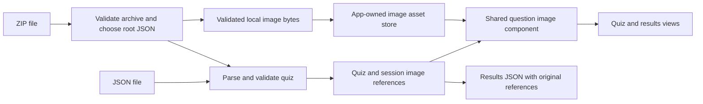

# Practice Quiz images — Proposal

Status: Proposed implementation plan · Updated: 2026-11-07

## Overview

Support images on both multiple-choice and short-answer question prompts. Keep ordinary JSON uploads, including JSON containing image URLs. Add ZIP uploads for quizzes whose images should travel with the questions. Both inputs produce the same quiz model; ZIP is a packaging option, not a second question format.

This plan complements the [short-answer work](t3-thread://v1/30d0afaa-d2b4-45ea-8c4c-60918ed2e166), including mixed question types, per-question marks, hints, existing results downloads, and drag-and-drop. That work is underway in a separate checkout. This document proposes the image feature; application behavior has not been changed.

## The Problem

The current uploader reads one JSON file as text. Questions, generated sessions, and results have no image fields, and question text is rendered as plain text. A local filename in JSON cannot give the browser access to a photo beside that file. Authors need either a publicly reachable image URL or a package that supplies the actual bytes.

Images must survive question selection, shuffling, settings changes, results review, and reruns without changing scoring or hint usage. Saved results must retain meaningful image references rather than browser addresses that stop working after the page closes.

## Proposed Solution

The existing picker and drop area accept one `.json` or `.zip` file. Existing quizzes continue to work unchanged. Authors choose:

| Input | Contents | Use |
|---|---|---|
| JSON | Questions without images, or with HTTPS image URLs | Small file; hosted images require network access |
| ZIP | One or more root JSON files; images anywhere in the archive | Portable question images without image hosting |
| ZIP with mixed sources | Local images and HTTPS references in the same JSON | Supported, though remote images still require network access |

The only required layout rule is that quiz JSON files sit at the ZIP root; their filenames are unrestricted. Images can sit beside them or in any subfolder. Every local `src` is relative to the ZIP root: `photo.jpg`, `images/photo.jpg`, and `week-1/figures/photo.jpg` are all valid.

With one root JSON file, load it automatically. With multiple root JSON files, show a keyboard-accessible “Choose a quiz” list of filenames and require a selection before loading. Do not merge quizzes, pick the first file, or give `quiz.json` special priority. Validate the selected file as a quiz; if it is invalid, show its error and allow another selection. Unselected JSON files do not have to be valid quizzes. Nested JSON files are not quiz candidates.

Example package (folder names are illustrative):

```text
biology.zip
├── biology.json
├── revision.json
├── cell.png
└── figures/
    └── tissue.jpg
```

Add an optional `images` array to every question. Array order is display order. Each entry has required nonblank `src` and `alt` strings, plus an optional plain-text `caption`. Omitting `images`, or using `[]`, renders no image area. Reject `null` and malformed entries.

The following proposed `biology.json` demonstrates both types using the same image definition:

```json
{
  "title": "Biology revision",
  "questions": [
    {
      "id": "mcq-1",
      "question": "Which structure is labelled A?",
      "images": [
        {"src": "cell.png", "alt": "Cell diagram with structure A indicated"}
      ],
      "correct_answers": ["Nucleus"],
      "incorrect_answers": ["Cell membrane", "Mitochondrion"]
    },
    {
      "id": "sa-1",
      "type": "short_answer",
      "marks": 4,
      "question": "Describe two features visible in this tissue sample.",
      "images": [
        {
          "src": "figures/tissue.jpg",
          "alt": "Microscope photograph of the tissue sample",
          "caption": "Figure 1 — sample at 100× magnification"
        }
      ]
    }
  ]
}
```

For a JSON-only upload, replace each local `src` with a direct image URL such as `https://example.org/images/cell.png`. This URL is illustrative; use a real image endpoint, not a sharing page. Alternative text should describe the information needed to answer without unnecessarily revealing the answer.

Display images below the question text and above either answer control. Preserve aspect ratio, fit the available width without cropping, and offer keyboard-accessible enlargement for detailed diagrams. Show captions and a clear failure message with the alternative text when a remote image cannot load. Results show the same figures with the learner's response.

## Technical Architecture



### Shared model and display

Add `QuizImage { src, alt, caption }` and default-empty `images` on `QuizQuestion`. Preserve them when constructing `SessionQuestion`, results, and exports, outside the question-kind variants. Do not consume random numbers for images or change option shuffling. A reusable `QuestionImages` component serves both types and results, including any study-review surface that displays the prompt.

Keep parsed source references separate from resolved display URLs. An app-owned asset store maps archive paths to browser Blob URLs and owns their cleanup. Reuse one entry when several questions reference the same image. Browser object URLs refer to Blob data and must be released when no longer needed; they are runtime resources, not portable identifiers. See the [File API specification](https://www.w3.org/TR/FileAPI/).

Retain assets through settings, submission, and both rerun modes. Revoke them on successful quiz replacement, explicit discard, or app teardown. Returning to the upload screen alone must not invalidate a still-retained quiz. Failed or superseded imports release their provisional URLs and leave the active quiz intact. Refresh retains the existing behavior of losing the in-memory quiz; bundled images do not add persistence or make the app itself available offline.

### Import contract

Use one importer for picker and drop events. Read bytes, dispatch by supported extension, then validate content; browser MIME labels are not authoritative. Plain JSON parses as before, with added image validation. Local references in plain JSON produce an actionable error: “Question mcq-1 references cell.png. Upload a ZIP containing the quiz JSON at its root and that image at the referenced path, or use an HTTPS image URL.”

ZIP rules:

- Require at least one root file with a `.json` extension (case-insensitive); any filename is accepted. Load the sole candidate automatically, or show all root candidates sorted by filename for explicit selection. Do not parse unselected candidates or silently strip enclosing folders. If none exist, explain that a quiz JSON file must be placed at the ZIP root. Canceling selection preserves the active quiz. A selected-file validation error leaves the chooser available; a new upload supersedes the pending chooser and its archive.
- Local sources are case-sensitive paths relative to the ZIP root, with no required folder or filename pattern. Match exact entry names; spaces and Unicode are allowed. Do not URL-decode paths. Reject absolute paths, backslashes, empty segments, `.`/`..` segments, and duplicate names. Reject symlinks and encrypted archives. Ignore ordinary directory entries and common macOS metadata (`__MACOSX/`, `.DS_Store`). Allow unrelated files and arbitrary folders; do not extract or interpret unreferenced entries. Archive-wide path, entry-count, and declared-size checks still apply.
- Initially support PNG, JPEG, WebP, and GIF image files. Check file signatures and successful browser decoding, not just extensions. Reject referenced SVG and other unsupported image formats in this version. Ignore unreferenced files after archive validation; repeated references are allowed. Missing referenced files or corrupt referenced images reject the import before replacing current state.
- Support stored and Deflate ZIP entries. A candidate is the Rust `zip` crate with default features disabled and a pure-Rust Deflate backend; its documentation describes WASM support with feature restrictions. Pin a compatible version only after checking a browser build. See the [crate documentation](https://docs.rs/zip/latest/zip/).
- Proposed initial limits: 50 MiB uploaded ZIP, 2 MiB manifest or standalone JSON, 1,000 entries, 10 MiB per image, 100 MiB aggregate declared uncompressed files, and 20 megapixels per referenced image. These are new limits, including the JSON limit, and need representative-quiz checks before release. Enforce actual decompressed-byte caps as well as declared sizes, read at most limit + 1 bytes, and check dimensions before full decoding. Process images sequentially to bound transient memory. A small oversized archive must never cause unrestricted extraction.

Return a validated quiz plus its asset store, then commit all existing reset actions once. Preserve the short-answer upload pipeline's protection against overlapping loads; an older completion must not overwrite a newer selection. Show loading feedback during ZIP preparation. Hold the bounded archive while the chooser is open; create image assets only for the selected quiz. Selection, validation, and final commit share the upload generation guard so stale chooser actions cannot replace a newer upload.

Remote sources must be absolute HTTPS URLs without embedded credentials. Reject other schemes, protocol-relative URLs, and caller-supplied `blob:`/`data:` values. Render remote images directly through `` rather than fetching them into the ZIP store. Do not require URL suffixes: image hosts can use extensionless endpoints. Remote format and size cannot be validated like bundled files; treat load failure as a visible recoverable error, not a rejected quiz. Use `referrerpolicy="no-referrer"` ([browser documentation](https://developer.mozilla.org/en-US/docs/Web/API/HTMLImageElement/referrerPolicy)); hosts still receive image requests. URL images need publicly accessible hosting and may expire or block embedding.

### Results and integration

Keep Copy Results JSON and Download Results JSON as JSON. Export each question's original `images` array, never resolved Blob URLs or embedded base64. URL references remain usable while hosted. Bundled paths require the original quiz ZIP, so describe results JSON as an answer record, not a self-contained image archive. Include `source_file` as the uploaded ZIP filename and set `source_manifest` to the exact selected root JSON filename (for example, `"biology.json"`) for ZIP input, or `null` for standalone JSON.

PR #5 implements results version 3. Target version 4 for this follow-on export contract and document it; confirm the merged version before implementation. Short-answer responses, marks, hint history, and MCQ answer mappings remain governed by that feature. Image viewing never marks a hint as viewed or changes an answer or score.

Likely files: `src/model.rs`, new `src/import.rs` and `src/components/question_images.rs`, app-owned assets in `src/main.rs`, upload/quiz/results components, `assets/main.css`, schema, upload format reference, README, examples, and tests. Add images to the shared `QuizQuestion.properties` schema; PR #5 uses `if`/`then`/`else` for answer-option requirements rather than separate question definitions.

### Integration checked against PR #5

Compared with [PR #5](https://github.com/Ozy-Viking/practice-quiz/pull/5) at head `bb7526872234815d61cb442a4d5e91a8686e385d`. It was open when checked. No image-related prerequisite change to that PR was identified; update this branch onto merged `main` before implementing images and recheck any subsequent changes.

- **Deserialization:** `QuizQuestion` uses `#[serde(try_from = "QuestionInput")]`. Add default-empty `images` to both structs and transfer it in `TryFrom<QuestionInput>`. Adding it only to the public question struct would not wire up JSON input. Keep explicit `null` invalid. Carry images through session construction and `build_results` into the common `QuestionResult` fields.
- **Export:** Add `images` to common `QuestionExport`, outside flattened `ExportDetails`, so both variants receive it. Add selected manifest provenance to `ResultsExport` and the copy/download call path. Preserve version 3's unmarked statuses, optional percentage, available marks, and hint snapshots when moving to version 4.
- **Importer:** Extend the existing shared `upload` closure used by picker and drop. Its `read_quiz_file` currently returns text via browser `File.text()`; ZIP support needs a bounded byte-reading path. Retain `upload_generation` checks, and check again after each new asynchronous archive/image stage and before final commit. The root-JSON chooser belongs to that same pending import generation.
- **Cancellation:** PR #5 retains completed results when opening “Load New Quiz” and offers “Back to Results,” which invalidates pending uploads. Keep the active image store and `source_manifest` alongside that retained attempt. Returning to results must discard only pending ZIP/chooser resources. Only a fully validated replacement swaps the active assets and provenance, then performs the existing response/hint resets.
- **UI and schema:** Put image rendering outside `QuestionType`/`ResultDetails` branches. Declare images once in the shared schema properties, retaining conditional MCQ/short-answer option rules. Extend the upload format reference with the image-object fields and ZIP examples.
- **Regression coverage:** Extend the existing `tests/short-answer.spec.ts` replacement-upload/cancellation tests with bundled images and multi-JSON selection. Verify old images, answers, hint history, and export provenance survive failed or canceled replacement, and all switch together on success. Update explicit version-3 export expectations to version 4 while preserving their other assertions.

## MVP Scope

Include prompt images, multiple images per question, captions and alternative text, enlargement, URL-only JSON, ZIP imports with arbitrary image locations and root-JSON selection, picker/drop parity, results review, and exported references. Preserve legacy JSON quizzes, marks, hints, filters, seeds, and reruns.

Image answer options, images inside hints or explanations, Markdown/HTML parsing, learner image responses, cloud hosting, browser persistence, and self-contained results ZIP downloads are separate extensions. In particular, MCQ answer strings retain their existing format.

## Phasing & Milestones

1. **Integrate with short answers.** Read the landed models and shared upload path; add the common image contract, schema examples, and original-reference exports.
2. **Deliver URL support.** Add shared rendering, enlargement, load errors, and lifecycle tests for both types. Existing JSON uploads remain the main regression gate.
3. **Deliver ZIP support.** Prove the dependency builds for `wasm32-unknown-unknown`, implement bounded import and asset ownership, then enable ZIP picker and drop support.
4. **Verify and document.** Add an actual sample ZIP and equivalent URL JSON example. Run formatting, Rust tests, the browser build, and Playwright integration tests. No delivery date is assumed.

Acceptance tests must cover legacy JSON and seeded order; JSON URLs and mixed-source ZIPs for both question types; multiple figures and repeated references; root images and arbitrarily nested image folders; arbitrary JSON filenames; single-candidate automatic loading; multiple-candidate selection without preferential treatment of `quiz.json`; invalid selected JSON with recovery; ignored invalid unselected JSON and unrelated files; nested-only JSON rejection; chooser cancellation and stale-selection races; exact selected filename in exports; missing manifests/images, unsafe paths, duplicate entries, corrupt images, unsupported compression, and every limit; picker/drop equivalence and racing imports; failed-upload state preservation; settings, results and rerun retention; cleanup on replacement; remote failure and retry; captions, alternative text, keyboard enlargement, and narrow screens. Copy/download must produce equivalent JSON containing original references and no `blob:` URLs. Verify short-answer text and hint history remain unchanged when images are opened. Use local controlled image endpoints in browser tests.

## Risks & Mitigations

| Risk | Mitigation |
|---|---|
| Overlapping short-answer changes | Implement against the landed common model and importer; keep images independent of answer kind. |
| ZIP or decoded-image memory exhaustion | Bound compressed and decompressed sizes, entries, dimensions, and concurrent processing. |
| Image URLs expire or refuse embedding | Visible failure state and retry; recommend bundled files when portability matters. |
| Results references appear self-contained | Document that local images remain in the source ZIP; never export temporary URLs. |
| Asset cleanup breaks review or leaks memory | One app-level owner, staged imports, and lifecycle tests across all transitions. |

## Open Questions

1. **Representative size** — Do real teaching quizzes fit the proposed limits? Check sample materials before finalizing limits.
2. **Browser performance** — Does bounded ZIP decoding remain responsive on target phones? Measure during the WASM spike; use a worker if necessary.

Neither question changes the proposed authoring contract. The first version assumes images belong to question prompts; richer placements can reuse this source format later.
