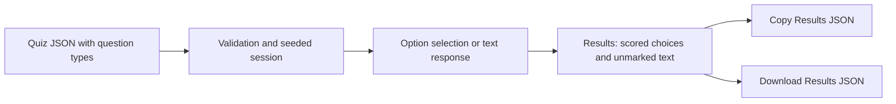

# Practice Quiz short answers — Proposal

Status: Draft implementation plan · Date: 2026-11-06

## Overview

Add unmarked short-answer questions alongside multiple-choice questions in the same quiz. Learners type responses, submit the attempt, and retain their answers through the existing **Copy Results JSON** and **Download Results JSON** actions. The user confirmed mixed question types and reuse of this export mechanism. Browser autosaving is not part of this plan. The user also requires available marks to remain visible for every question, including unmarked short answers.

## The Problem

The current model assumes every question has correct and incorrect answer options. Validation requires a correct answer, the quiz view renders option buttons, and results assign every question a score and correctness status. Responses are held in memory as selected option IDs. Supporting typed responses requires changes throughout this flow so an unmarked response is never treated as an incorrect multiple-choice answer.

The existing export already includes question text, metadata, source filename, seed, and results. Extending that document gives written answers enough context to be useful after download without adding another storage system.

## Proposed Solution

The upload screen accepts a quiz JSON file through either the existing file picker or a clearly labeled “Drop a JSON quiz here, or choose a file” area. Highlight the drop target while a file is over it and prevent the browser from navigating to the dropped file. Retain keyboard-accessible file selection for keyboard and touch users. Accept one file at a time; report multiple-file drops, unreadable files, malformed JSON, and invalid quiz content through the existing error display. Both paths use the same validation and successful-upload state reset. A rejected drop leaves existing quiz state intact.

Quiz authors specify `"type": "short_answer"` on questions that accept text. Questions without a type retain their existing multiple-choice behavior; explicit `"type": "multiple_choice"` is also accepted.

```json
{
  "id": "sa-1",
  "type": "short_answer",
  "marks": 5,
  "question": "Explain why this approach works.",
  "hints": ["Consider the initial conditions.", "Which property stays unchanged?"],
  "metadata": { "topic": "Reasoning" }
}
```

Both question types accept an optional positive numeric `marks` field. Resolve available marks in this order: question `marks`, top-level `marks_per_question`, `config.marks_per_question`, then the existing default of 1. Omitting `marks` preserves current behavior. For example, the question above is worth 5 marks even when the quiz default is 1. Fractional marks are supported; reject zero, negative, nonnumeric, null, and non-finite values.

Multiple-choice (MCQ) and short-answer questions both accept an optional `hints` array of plain-text strings. The same reveal controls, viewed-history tracking, results display, and JSON export rules apply to both types. Omitted or empty arrays mean no hints: render no hint button, link, disabled control, or hint placeholder. Questions without hints also show no hint-usage badge in results. Reject non-string and whitespace-only entries. Display one keyboard-accessible “Show next hint” button per question with hints. Each activation reveals the next hint in source order, and revealed hints stay visible in separate blocks with source line breaks preserved. Remove the button after all hints are revealed. Use `aria-controls` to associate the button with the hints region and render text safely. Determine the next index from current usage at activation so rapid clicks advance sequentially.

Record which hints were revealed during the attempt. Once a hint has been viewed, changing/clearing the answer does not erase that record. Viewing a hint does not count as answering the question and does not change marks. Results show “Hints viewed: 1 of 2” or “No hints viewed” for questions with hints. The recorded usage is fixed at submission; result review does not alter attempt history.

Short-answer questions display an accessible multiline text area and an “Unmarked” label. A response counts as answered when it contains non-whitespace text. Preserve the original text, including whitespace and line breaks, for review and export. Submission remains possible with blank answers.

Results show the response with a neutral “Answered — unmarked” or “Unanswered — unmarked” label. Display available marks for every question, including short answers, using each question’s resolved marks. Short answers show, for example, “Available marks: 5” without an awarded score. No correctness verdict or grading controls appear for these questions. In mixed quizzes, label the score as applying to multiple-choice questions only. Show total available marks across all questions separately from the multiple-choice score. For an entirely short-answer quiz, show completion counts and total available marks without an awarded score, percentage, or grade banner. Keep short answers out of the score-based Study Review list; their responses remain visible in the main results.

## Technical Architecture

Keep the existing Dioxus/Rust application and browser export implementation.



| Area | Planned change |
|---|---|
| `src/model.rs` | Add question types, optional `marks` overrides and `hints`, typed responses, unmarked results, validation and export support. |
| `src/main.rs` | Own response state covering selected option IDs and short-answer text, plus per-question viewed-hint records independent of answers. |
| `src/components/quiz.rs` | Render input by question type; count both response types; reveal hints on request and record first viewing. |
| `src/components/results.rs` | Render unmarked responses, hint usage, and conditional score summaries; reuse export controls. |
| `src/components/config.rs`, `upload.rs` | Carry and clear typed responses through existing lifecycle transitions. |
| `src/components/upload.rs` | Share file reading, parsing, validation, and state updates between the picker and drop handlers; add drag feedback and single-file handling. |
| `assets/quiz-schema.json` | Define conditional requirements for each question type and optional positive numeric `marks` and plain-text `hints` arrays, retaining existing aliases. |
| `assets/main.css` | Style text areas, neutral result states, and the upload drop target with hover and focus states for both themes. |

Use a response enum keyed by question ID, with choice-selection and text variants. Carry the question type through the generated session. Represent result details by kind so text responses do not acquire synthetic correctness data. Resolve marks once when building the session and retain them through reruns, results, and exports. Every result retains its available marks. Multiple-choice scoring keeps its existing credit/penalty formula, scaled by that question’s resolved marks. Sum resolved marks for totals rather than multiplying the question count by the default. Replace the settings text “Each question is worth …” with default-marks wording that explains question overrides. Display fractional marks without rounding them to whole numbers. Only multiple-choice results contribute to awarded-score totals and the scored maximum used for percentages; separately sum available marks across all questions.

Reject unknown question types and duplicate IDs. Preserve current multiple-choice validation and aliases. Short-answer questions require no answer options; reject nonempty option arrays on them to catch authoring mistakes. Omitted or empty arrays are acceptable. Update schema and runtime validation together.

Keep the existing randomization path unchanged for legacy quizzes, protecting the seeded-order fixture. Short-answer questions participate in question selection and shuffling but have no options to shuffle. Existing topic/location filters and question-count settings apply to both types.

Store viewed hints as a set of zero-based indices per question ID and use that same state for visibility; no separate hide state is needed. Carry hint text in the session so indices refer to stable source order, including when questions are shuffled. Record a view only when an existing hint is actually revealed; ignore reveal requests for missing questions or out-of-range hint indices. Derive `hints_viewed` from valid viewed indices for that question, rather than maintaining an independent flag. A question with no hints must always have `hints_viewed: false` and `viewed_hint_indices: []`, including if stale or invalid usage state is encountered. Snapshot usage into results at submission. Clear both visibility and viewed-history state whenever an attempt resets; reruns retain hint definitions but start with all hints hidden and unviewed. Failed uploads preserve usage along with the rest of the current attempt.

Extend results JSON to `format_version: 3`. Retain the multiple-choice answer mappings and add a `type` discriminator to each question. Short-answer entries contain `id`, `text`, `type`, `response`, `status`, `max_score`, and `metadata`; use `answered_unmarked` or `unanswered_unmarked`, retain `max_score` as the question’s available marks, and omit awarded `score` and option fields. For both question types, also export `hints` (the source-order text array), `hints_viewed` (a boolean), and `viewed_hint_indices` (sorted unique zero-based indices). Questions without hints export `[]`, `false`, and `[]` respectively. Exported hint content is study material; the viewed-history fields record actual use during the attempt. Keep `question_count` as the total; add `scored_question_count`. Add `total_available_marks` covering every question. Existing `total_score` and `total_max` cover multiple-choice questions only; export `percentage: null` when none exist. Both export buttons must serialize the same document. This is a proposed versioned contract change, including for multiple-choice-only exports.

## MVP Scope

- Drag-and-drop quiz JSON upload alongside the existing accessible file picker.
- Mixed and entirely short-answer quizzes, with plain-text multiline responses.
- Optional click-to-reveal hints for both question types, with per-question usage recorded in results and JSON exports.
- Optional question-level `marks` overrides for both question types, with the existing quiz default as fallback.
- Unmarked response review, available marks per question, and existing JSON copy/download after submission.
- Existing filtering, seeded sessions, reruns, and metadata support.
- Existing lifecycle semantics: refresh loses in-memory responses; rerun starts blank; returning to settings or successfully loading another quiz clears the attempt. Failed uploads must not destroy the current state.

Automatic/manual marking, browser persistence, answer-file import, draft export, cloud saving, rich-text editing, and additional download formats are outside this version.

Success means a learner can upload a mixed quiz, enter text, submit, and download those exact responses while preserving existing multiple-choice behavior for quizzes without marks overrides.

## Phasing & Milestones

1. **Model and input contract.** Add question/response/result variants, question-level marks resolution, hint definitions and usage tracking, and validation. Update the JSON schema and sample quiz. Verify legacy parsing and seeded fixtures still pass.
2. **Quiz interaction and lifecycle.** Add labeled text areas, answer counting, and accessible hint reveal controls. Wire responses through submission, settings, upload, and both rerun modes. A rerun must clear both kinds of answer and all hint visibility and usage records.
3. **Review and export.** Add neutral response rendering, available marks per question, total available marks, mixed-score labeling, the all-unmarked summary, and hint usage indicators. Implement version 3 exports through the existing copy/download functions and retain their error feedback and cleanup.
4. **Drag-and-drop upload.** Extract the existing upload pipeline for reuse by file-picker and drop events. Add the drop target, drag feedback, default-navigation prevention, and clear handling for multiple files and invalid drops. Ignore non-file drags. Keep validation authoritative rather than relying on browser-supplied MIME types, which may be absent. Clear drag feedback on leave, drop, and failure; serialize loading so overlapping uploads cannot overwrite newer state.
5. **Documentation and verification.** Update README and the upload screen's embedded example/field reference, including drag-and-drop instructions. Add Rust tests and Playwright coverage, then run `cargo test`, `cargo fmt --check`, and `npm run test:e2e` with the configured Dioxus browser build.

Tests should cover marks precedence and fallback, fractional overrides, invalid marks values, weighted multiple-choice scoring and percentages, preservation of marks through reruns and exports, available marks per question and across the quiz, separation of total available marks from the scored denominator, mixed-score arithmetic, blank/whitespace responses, Unicode and multiline round trips, all-unmarked results, unknown types, duplicate IDs, filtering and reruns. Browser tests should verify that HTML-like text renders literally, text input survives rerenders, copied and downloaded responses match, and export failures still allow retry. Existing multiple-choice scoring and seeded-order tests remain regression gates. Timeline is unspecified.

For both question types, explicitly test omitted `hints` and `hints: []`: no hint control or placeholder is rendered, no hint-usage badge appears in results, and both copy and download export `hints_viewed: false` and `viewed_hint_indices: []`. Test that invalid reveal requests and stale indices cannot mark a hintless question as viewed.

Run hint tests for both MCQ and short-answer questions, including a mixed quiz. Cover invalid hint arrays, initially hidden text, keyboard and pointer activation, sequential reveals, earlier hints remaining visible, terminal button absence, rapid activations, retained usage after answer edits, and no change to answered counts or scores. Verify exact viewed indices and boolean flags in both exports, unanswered questions with viewed hints, usage frozen at submission, and cleared history on reruns and successful replacement uploads.

Upload browser tests should exercise valid mixed-quiz drops, missing MIME types, malformed JSON, invalid quiz content, multiple-file drops, non-file drags, and recovery after failure. Confirm picker/drop equivalence, preserved state on failure, cleared drag highlighting, no browser navigation on drop, and continued keyboard access to the picker.

## Risks & Mitigations

| Risk | Mitigation |
|---|---|
| Unmarked answers lower the displayed score | Retain their available marks while excluding them from awarded-score totals and the percentage denominator; test mixed and all-unmarked attempts. |
| Export consumers assume version 2 | Explicit version bump, documented variant shapes, and export assertions. |
| Responses leak into a rerun or another quiz | Centralize response clearing and test every existing reset transition. |
| Added branching changes legacy seeded order | Preserve the old randomization sequence and retain fixed-fixture tests. |
| Answer text is altered or interpreted as markup | Preserve raw strings and render them as escaped text with visible line breaks. |

## Implementation Assumptions

- Questions without `marks` use the existing effective `marks_per_question` default. A question’s explicit `marks` overrides that default for both question types; short-answer marks remain available marks only.
- Hint use is recorded for study review only and carries no mark penalty. Usage records share the existing in-memory attempt lifetime and are retained externally through copy/download.
- Results exports move to version 3 using the contract described above. External consumers of version 2 will need to accommodate the new format.
- Existing study metadata remains available after submission. No new reference-answer or marking feature is proposed.
