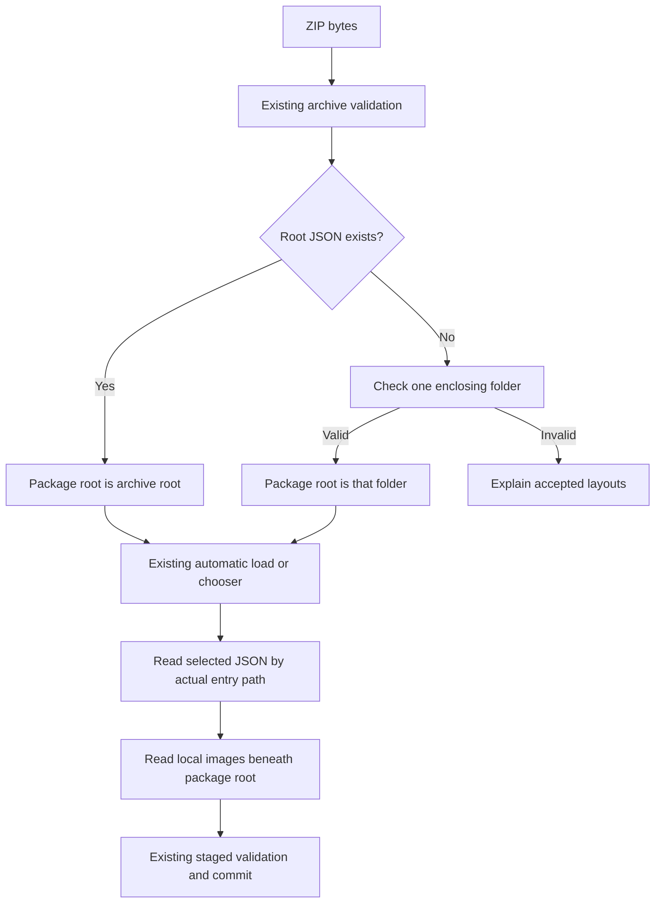

# Practice Quiz folder ZIP upload plan

Status: Implemented and verified; three independent implementation reviews completed · Date: 2026-11-08

## Overview

Allow authors to compress a correctly structured quiz folder and upload the resulting ZIP directly. Support both the existing archive-root layout and a single enclosing folder, with the same quiz JSON and image references in either package. Quiz JSON may be at depth 0 (`quiz.json`) or depth 1 (`my-quiz/quiz.json`) only; depth 2 (`outer/my-quiz/quiz.json`) and deeper are unsupported. This limit applies to quiz discovery; image subfolders may still be nested beneath the package root.

## The Problem

`Archive::new` in `src/import.rs` only considers JSON files whose names contain no slash. `load` subsequently looks up local images using `src` directly as the archive entry name. Consequently, compressing a folder adds a path prefix that prevents manifest discovery; accepting the manifest alone would still leave its image paths unresolved.

The README and upload reference explicitly require root JSON files, and native/browser tests assert rejection of nested-only manifests. This change needs an updated import contract, image lookup, documentation, and regression coverage together.

## Proposed Solution

Accept these equivalent packages:

```text
Contents compressed                 Folder compressed
biology.zip                         biology.zip
├── quiz.json                        └── biology/
└── figures/                             ├── quiz.json
    └── cells.png                       └── figures/
                                            └── cells.png
```

Both manifests retain `"src": "figures/cells.png"`. An author can zip the folder or its contents without editing JSON. Folder names and JSON filenames remain unrestricted within existing path validation.

Detect the package root deterministically:

1. If archive-root JSON candidates exist, retain the existing root behavior and ignore nested JSON for selection.
2. Otherwise, disregard directory records and recognized metadata when examining layout. Require all remaining files to share one enclosing folder, with at least one JSON file immediately inside it.
3. Use that folder as the package root. Do not recursively search deeper folders or choose between sibling quiz folders.
4. Load one candidate automatically; show the existing sorted chooser for multiple candidates. Invalid selections remain recoverable, and unselected JSON is not parsed.

For unsupported layouts, explain both accepted structures: “Put quiz JSON and its images at the ZIP root, or together inside one enclosing folder.” A normal root-level file alongside a wrapped quiz makes the wrapper layout unsupported; recognized macOS metadata does not.

## Technical Architecture



In `src/import.rs`, retain the existing map of exact decoded archive entry names. Add a package-root prefix to `Archive`, and derive candidates after validating the complete directory. Keep candidates as actual archive paths, such as `biology/quiz.json`, so selection, reads, and provenance refer to the same entry. Full paths can also be used as chooser labels.

For a local image, validate the original `src` using the existing rules, then prepend the package-root prefix for lookup. Never retry against the archive root when a wrapped image is missing: that could silently select a different image. Keep asset-store keys and quiz image references as the original `src`, preserving rendering, deduplication, and results exports. HTTPS sources bypass this resolution.

Preserve validation of every original archive entry before layout detection, including ignored metadata. Keep duplicate decoded-name detection, bounded reads, size and entry limits, image checks, and symlink/encryption/compression rules. Apply metadata rules consistently to layout detection, candidate discovery, and referenced-image reads: recognize `__MACOSX/` at the archive root or detected package root, plus `.DS_Store`. Reject image references to those metadata entries. Do not broadly hide deeper folders named `__MACOSX` within an ordinary image path.

Export the actual selected path in `source_manifest`: `biology/quiz.json` for a wrapped package and `quiz.json` for an existing root package. Keep `source_file` as the uploaded ZIP filename and `images[].src` unchanged. Retain results format version 4 because the fields and value types stay the same; document the broader manifest-path meaning.

## MVP Scope

Deliver one enclosing folder through both picker and drag-and-drop, including multiple manifests, nested image folders, mixed local/HTTPS sources, spaces, Unicode, and case-sensitive matching. Preserve standalone JSON behavior and the existing staged replacement/cancellation lifecycle.

Direct folder uploads, multiple independent package folders, recursive manifest discovery, and rewriting image paths are outside this change.

## Phasing & Milestones

1. **Importer:** add package-root detection, candidate discovery, prefixed image lookup, and actionable errors in `src/import.rs`.
2. **Documentation:** update `README.md`, the upload reference and error strings in `src/components/upload.rs`, and the image-source description in `assets/quiz-schema.json`. Add a wrapped sample ZIP and explain both layouts. Treat this plan as superseding the original image proposal's prohibition on enclosing folders.
3. **Verification:** extend the deterministic fixture generator, native import tests, and `tests/images.spec.ts`; validate the browser build and existing regressions.

Required acceptance coverage:

- Equivalent root and wrapped packages load the same questions and images; repeated references share assets. Explicitly accept `quiz/quiz.json` with `quiz/images/a/b/c/d/image.png`.
- One manifest auto-loads; multiple wrapped manifests require selection. Test two distinct valid quizzes, invalid-JSON recovery, and recovery after a selected manifest creates an image URL then fails on a later image; provisional URLs must be revoked.
- Root candidates retain priority even when nested JSON exists. An invalid root candidate must fail without falling back to a valid wrapped quiz.
- Metadata and optional directory records do not affect valid wrapper detection.
- Substantive files in sibling folders, deeper-only manifests, unrelated root files, and missing images produce clear errors. Empty sibling directory records are harmless. A missing wrapped image never resolves to an archive-root image. Deeper JSON beside a valid immediate manifest is ignored.
- Unsafe paths, decoded-name collisions, and existing limits remain rejected before replacement.
- Picker and drop both load wrapped packages; results preserve the exact manifest path and original image references.
- Failed, canceled, and superseded wrapped uploads preserve the active quiz and release provisional assets.

Review existing `nested.zip` assertions individually: that fixture currently places JSON in a folder but images at the archive root, so it remains invalid under this contract. Introduce a genuinely wrapped fixture for success, and update existing error-message expectations and race tests deliberately.

Implementation verified at `8c3f5fb`, rebased onto `main` at `6e88d8c` including merged PR #6:

- `cargo test --locked`: 68 passed, including 7 new native import tests; the pre-change baseline passed all 61 tests.
- `python -m unittest discover -s tests -p schema_test.py`: 3 passed.
- `cargo fmt --check`, `git diff --check`, and `dx build --web`: passed.
- `QUIZ_TEST_PORT=8107 npx playwright test --project=chromium --project=firefox --reporter=line`: 142 passed in 41.2 seconds against a fresh app build, including 18 added browser cases across the two browsers.
- Three independent read-only reviews of `6e88d8c…8c3f5fb` covered standards, specification compliance, and archive correctness; all returned no findings.

WebKit launch was attempted separately and failed because host libraries `libicu74`, `libxml2`, and `libflite1` are missing. WebKit tests were not run. The installed Dioxus CLI reports a 0.7.10/0.7.9 version mismatch; the browser build nevertheless exits successfully and the browser suite passes. No dependency versions were changed.

## Risks & Mitigations

| Risk | Mitigation |
|---|---|
| Wrong images selected after adding a wrapper | Resolve strictly beneath one detected package root; never use fallback lookup. |
| Existing ZIP behavior changes | Root candidates retain priority; retain existing root-layout regressions. |
| Metadata interferes with folder detection | Exclude recognized metadata from layout analysis while validating every entry. |
| Stale upload replaces a newer quiz | Reuse existing generation guards, cancellation, and staged asset ownership. |

## Open Questions

No blocking scope questions remain. Support for several nested enclosing folders or multiple independent quiz folders is outside the confirmed scope.
